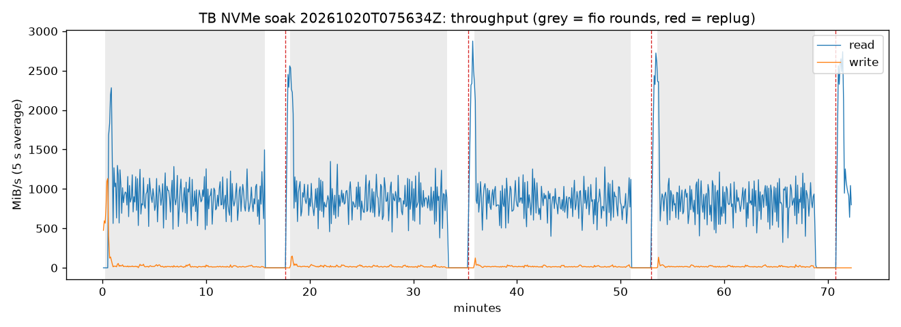

# apple-silicon-thunderbolt-linux

PCIe over Thunderbolt/USB4 for Apple M1 Pro/Max/Ultra Macs on Linux: the
`pcie-apple-apciec` driver, its device-tree binding and nodes, and the tools
used to test it.

**Unofficial and experimental.** Not affiliated with or endorsed by Apple,
Asahi Linux or Fedora. Don't report problems from this code to Asahi Linux
or Fedora; open an issue here.

Ready-made Fedora Asahi Remix packages that include it are planned in
[aquarat/apple-silicon-kernel-plus](https://github.com/aquarat/apple-silicon-kernel-plus).

A Linux PCIe host driver and device-tree binding for the PCIe root complexes
("APCIEC") behind the USB4/Thunderbolt ports of Apple T600x SoCs (M1 Pro,
M1 Max, M1 Ultra). With it, PCIe devices in USB4/Thunderbolt enclosures, such
as NVMe drives, work under Linux. Licence: GPL-2.0-only (driver), GPL-2.0-only
OR BSD-2-Clause (binding), GPL-2.0+ OR MIT (DTS), as usual for these trees.

Each USB4 port has its own root complex with one root port. The root port's
link never leaves the SoC. It runs over a PCIe tunnel that the USB4
connection manager (the Linux `thunderbolt` driver) builds through the USB4
link to the router in the enclosure. The port register block is the one
`pcie-apple.c` drives for the internal PCIe controller, plus a tunnel reset
handshake.

Tested on a Mac Studio (M1 Max, j375c) with a UGREEN ASM2464PD NVMe
enclosure on rear port 3: about 3 GB/s sequential reads, automatic recovery
from unplug/replug. See "Status" below for what has and has not been tested.

## Layout

| path | what |
|---|---|
| `drivers/pci/controller/pcie-apple-apciec.c` | the driver |
| `drivers/pci/controller/Kconfig.fragment`, `Makefile` | in-tree Kconfig entry and Makefile line (the Makefile also serves the out-of-tree build) |
| `Kbuild`, `Makefile` | out-of-tree module build |
| `Documentation/devicetree/bindings/pci/apple,t6000-apciec.yaml` | DT binding |
| `arch/arm64/boot/dts/apple/t600x-apciec.dtsi` | SoC nodes: APCIEC + DART for USB4 ports 0-3 of a die |
| `arch/arm64/boot/dts/apple/t600x-j375-apciec.dtsi`, `t600x-j314-j316-apciec.dtsi` | board parts (Mac Studio ports 0-3, 14"/16" MacBook Pro ports 0-2), included from the T600x board `.dts` files |
| `patches/` | the same as a 4-patch series on asahi-wip 7.2.11 (`git am`-able) |
| `patches/tb-net/` | separate 5-patch series for Thunderbolt networking (thunderbolt-net) on the Apple NHI, see below |
| `udev/60-apciec-nvme-apst.rules` | NVMe APST policy for drives behind APCIEC |
| `udev/61-thunderbolt-net-threaded.rules` | threaded NAPI for thunderbolt-net interfaces (see Thunderbolt networking) |
| `scripts/make-patches.sh` | regenerates `patches/` from this tree on a kernel git checkout |
| `tools/` | test tools: `tb-soak.sh` (filesystem soak with software replugs), `plot-soak.py` (graphs), `tb-port-cycle` / `tipd-4cc` (software replug through the port's USB-C PD controller; the address table is for the Mac Studio) |
| `docs/results/` | graphs from the soak runs quoted below |

## Requirements

- **Bootloader: m1n1 1.6.1 or later.** The register tunables
  (`apple,tunable-debug`, `-fabric`, `-rc` on the controller node and
  `apple,tunable` on its first child, the root port) are per-device data that
  m1n1 copies into the DT at boot. It finds the controller through the
  `usb4_N_pcie` alias. The driver refuses to probe without them. Neither the
  driver nor the DTS contains tunable values.
- **Kernel: the Apple USB4/Thunderbolt series** (Sven Peter's NHI, ACIO,
  atcphy USB4 mode and tipd work). Tested on asahi-wip 7.2.11
  (e09c62843a8e). Upstream 7.1/7.2 and the Fedora Asahi 7.1.13 kernel do not
  have it; the APCIEC driver itself builds against any of them, but there
  is no tunnel to drive without the series.
- Older kernels: `of_map_iommu_id()` is the only 7.2-only API used; on 7.1
  it is `of_map_id(np, rid, "iommu-map", "iommu-map-mask", &np, &sid)` (a
  small shim). Not build-tested against 7.1.13 headers.
- Kernel options: `CONFIG_PCIE_APPLE` (provides the MSI doorbell address
  and makes the DART driver reserve it), `CONFIG_APPLE_DART`,
  `CONFIG_APPLE_TUNABLE` (selected), `CONFIG_COMMON_CLK`, `CONFIG_PCI_MSI`,
  `CONFIG_USB4` and `CONFIG_USB4_APPLE_SOC`.
- DT nodes per the binding, with `dma-coherent` (mandatory: without it every
  DART mapping is uncached and throughput falls to about 570 MB/s; the
  driver refuses to probe without it).
- Something must authorize USB4 routers so that the connection manager
  builds the PCIe tunnel (boltd, or a udev rule written for your security
  policy). DMA from the enclosure goes through the port's DART.

## Building

Out of tree, against installed headers (e.g. `kernel-16k-devel`) or a
configured tree:

    make KDIR=/lib/modules/$(uname -r)/build
    sudo make KDIR=/lib/modules/$(uname -r)/build install

In tree: `git am patches/*.patch` on asahi-wip 7.2.11 (or apply
`Kconfig.fragment`/`Makefile` by hand), then `CONFIG_PCIE_APPLE_APCIEC=m`.
`scripts/make-patches.sh KERNEL_TREE OUT_DIR` regenerates the series from this
directory; its hunks are located by context, so porting to another base
means adjusting a few anchors. The patches carry an `Assisted-by:` tag
(Documentation/process/coding-assistants.rst): the code was written with an
AI coding assistant and reviewed and tested by the maintainer, whose
`Signed-off-by:` they carry.

## Device tree

Binding: `apple,t6000-apciec` (shared by T6000/T6001/T6002). Registers
`config` (256 MiB ECAM), `rc`, `port`, `fabric`, `debug`; one management
interrupt; `msi-controller` + `msi-ranges` (32 AIC lines, as `apple,pcie`);
`iommu-map` to the port's DART; `power-domains` (`ps_atcN_pcie`);
`dma-coherent`; `#clock-cells = <0>`; the root port as child `pci@0,0`.

The DART (`apple,t8110-dart`) is a normal top-level node, but it only
responds while the port's application clock runs, which needs the port to
be reset, tuned and enabled first. The controller therefore registers that
clock and the DART node references it (`clocks = <&apciecN>`). The DART then
cannot probe before the controller has started the clock (fw_devlink and the
clock lookup both defer it), and the driver waits for the DART to bind
before it scans anything. No runtime DT changes are involved.

Consequence: the driver cannot be unbound or unloaded at runtime. The bound
DART holds the clock, which keeps the module in use (`rmmod` fails with
"in use"), and manual unbind is suppressed as in `pcie-apple`. Unbinding
would have the driver core unbind the DART first; apple-dart's device links
then unbind the PCI functions parents first, and a bridge whose pcieport
driver goes away clears its bus-master bit, so nvme's own teardown stalls
(measured: 60 s of admin timeouts). Updating the module therefore needs a
reboot. The earlier lab driver created the DART with an `of_changeset`
after enabling the port and could be unloaded; that mechanism is not
acceptable upstream.

`t600x-apciec.dtsi` uses the `DIE_NODE()`/`DIE_NO` macros of
`t600x-dieX.dtsi` and is included for die 0 from `t6001.dtsi` (and hence
`t6000.dtsi`) and `t6002.dtsi`. All nodes are disabled there. The board
parts (`t600x-j314-j316-apciec.dtsi`, `t600x-j375-apciec.dtsi`) enable the
ports each board wires up and add the `usb4_N_pcie` aliases; they are
included from the T600x board `.dts` files (t6000-j314s/j316s,
t6001-j314c/j316c/j375c, t6002-j375d), not from the shared
`t600x-j314-j316.dtsi`/`t600x-j375.dtsi`, which T602x boards include too. The
second die of the M1 Ultra is not described (its ports are untested).

Note for kernels without the driver: an enabled DART whose controller has no
driver stays in the deferred-probe list (harmless, visible in
`/sys/kernel/debug/devices_deferred`).

Porting to the Fedora Asahi 7.1.13 tree: the dtsi only needs the
`ps_atcN_pcie` labels, `&aic`, and the `DIE_NODE` macros, all present there;
the board parts are included the same way.

## Runtime behaviour

- Probe resets the port, applies the tunables, deasserts local PERST, starts
  the application clock (which lets the DART probe), sets up MSI, applies
  the root-complex tunables to the root port and then waits for a tunnel.
- `TUNSTAT` bit 0 is polled (every 200 ms for 60 s after probe or a loss,
  then every second). Once it clears, the link is trained (immediately
  retried on LINK_DOWN; the first attempt on a fresh tunnel usually ends
  that way) and the bus is scanned. The host bridge is registered on the
  first link-up; scanning with the link down would fix the root port's
  bus numbers and strand switches behind it.
- Unplug or tunnel teardown raises TUNNEL_ERR/LINK_DOWN. The driver removes
  everything below the root port and waits for the next tunnel. The NVMe
  namespace is back about 3.9 s after the port is powered again.
- ASPM is disabled on every link below the root port: L1 across the tunnel
  drops the USB4 link within seconds (macOS never enables ASPM there either).
- `/sys/kernel/debug/<node>.apciec/regs`: read-only port register snapshot.
  `dyndbg="module pcie_apple_apciec +p"` adds link event and RID/SID
  messages. There are no module parameters.

## NVMe APST

Install `udev/60-apciec-nvme-apst.rules` (to `/etc/udev/rules.d/` or
`/usr/lib/udev/rules.d/`). It disables APST only for NVMe controllers behind
an APCIEC root port, by writing 0 to the controller's
`power/pm_qos_latency_tolerance_us`. With APST on, the ASM2464PD enclosure
dropped the USB4 link about 15 s after the drive went idle. The rule
matches the parent driver (`DRIVERS=="pcie-apple-apciec"`), so it does not
depend on node names, and it keys on the namespace's add event because the
controller's attribute appears only after the controller's own uevent.

In-kernel alternatives, evaluated (none needed now):

- The controller driver cannot set nvme quirks: `NVME_QUIRK_NO_APST` comes
  from nvme-pci's own ID/DMI tables, PCI fixups do not run from modules, and
  the nvme controller device (which carries the PM QoS knob) does not exist
  until nvme-pci has probed.
- A small nvme-pci change that skips APST for controllers below an
  external-facing/tunnelled port would work for every platform (macOS does
  the same for external drives), but it changes behaviour for all
  Thunderbolt NVMe and needs an upstream discussion first. Marking the
  APCIEC root port external-facing would also make the devices "untrusted",
  which switches them to strict IOMMU mode with bounce buffering, so that
  is a separate decision.
- `nvme_core.default_ps_max_latency_us=0` works but turns APST off for the
  internal drive too.

## Thunderbolt networking (patches/tb-net)

`thunderbolt-net` (IP over a USB4/Thunderbolt host-to-host cable) runs on the
Apple NHI, but loses frames whenever the receiver falls behind. The driver
enables end-to-end (E2E) flow control on its receive ring only, and the Apple
NHI's transmit ring ignores the returned credits unless E2E is enabled on it
as well (the register read-back shows the receive ring set up correctly and the
transmit ring without its E2E bit). macOS enables E2E on both. The series on
asahi-wip 7.2.11 (independent of the APCIEC series):

1. `thunderbolt: apple: Enable E2E flow control on Tx rings too` adds a
   `tx_e2e` flag to `struct tb_nhi` and sets it for the Apple NHI. No change
   for other host interfaces. The Falcon Ridge E2E workaround, for one, sends
   its credits nowhere, so a credit-gated transmit ring would stall against it.
2. `net: thunderbolt: Enable E2E flow control on the Tx ring if required`.
3. `arm64: dts: apple: t600x: Mark the USB4 NHIs as DMA coherent`.
4. `net: thunderbolt: Fix a lost Tx queue wakeup`: a race between stopping
   the Tx queue and the Tx completions could leave the queue stopped with
   every buffer free, after which the interface never sent again (seen
   after 19 minutes at 15 Gb/s per direction). Not Apple-specific.
5. `net: thunderbolt: Use a page pool for Rx buffers`: Rx pages stay DMA
   mapped and are recycled. Before, every 4 KiB frame took a new page that
   was cleared (16 KiB with `init_on_alloc=1` on a 16K-page kernel) and
   mapped and unmapped through the strict NHI IOMMU domain; that cost the
   receiving thread a whole core at 7-8 Gb/s. Not Apple-specific.

Measured with a USB4 cable between two ports of one Mac Studio (M1 Max, one end
in a network namespace, 20 Gb/s x2, MTU 65522, iperf3):

| | per direction | bidirectional | lost frames |
|---|---|---|---|
| unpatched (non-coherent NHI) | 3.4 Gb/s | | thousands per run |
| + dma-coherent | 4.2 Gb/s | 2.4 + 2.3 Gb/s | thousands per run |
| + TX E2E (patches 1-2) | 4.8 Gb/s | 2.3 + 2.3 Gb/s | 0 |
| + RX ring 1024, threaded NAPI, GRO off | 8.2 Gb/s | 7.4 + 7.4 Gb/s | 0, no TCP retransmits |
| patches 1-5, ring 256, threaded NAPI, GRO off | 21.2 Gb/s | 15.2 + 14.6 Gb/s | 0, no TCP retransmits |

With patches 1-5 the CPU cost at a fixed 5 Gb/s single stream drops from
0.86 to 0.40 CPUs for the whole loopback (both ends and iperf3), and the
receiving NAPI thread from 59 % to 17 % of a core. MTU 1500 gives the same
rates. A bigger RX ring no longer helps much (512 or 1024 entries: same single
stream, about 10 % more bidirectional), so the series leaves it at 256.
A 30 min bidirectional run with patches 1-5 averaged 15.2 + 14.7 Gb/s
(3.4 + 3.3 TB) with no lost frames, 28 TCP retransmits in total and every
SHA-256 checked 1 GiB transfer intact, while a tunnelled NVMe drive on a
third port ran a crc32c write/verify load (838 GB verified, no errors).
Before patch 4 the same run stopped transmitting after 19 minutes.

A 1 h bidirectional run at the last setting averaged 7.4 + 7.35 Gb/s with no
lost frames, one TCP retransmit, no link drops and 24 SHA-256 checked 1 GiB
transfers intact. Threaded NAPI (`echo 1 > /sys/class/net/<if>/threaded`) matters
because the interrupt controller cannot be pinned and delivers most ring
interrupts to the efficiency cores. GRO reorders segments on this path, which
causes spurious retransmits; at a 64 KiB MTU it has nothing to merge anyway.
The RX ring size is a compile-time constant (`TBNET_RING_SIZE`, 256 upstream).
Without patch 5 the limit was per-frame page clearing and DMA mapping (one
receive thread at ~96 % of a core). `udev/61-thunderbolt-net-threaded.rules`
turns threaded NAPI on for every thunderbolt-net interface; with patch 5 it
still takes a single stream from 13-14 to 17 Gb/s (measured with background
load) and from 9.5 to 21 Gb/s together with GRO off.

Patches 1 and 2 were boot-tested together on 7.2.11: the TX ring options
read back with the E2E bit set (0x90000000; 0x80000000 with an unpatched
thunderbolt-net), 0 lost frames, 5.1 / 4.7 Gb/s at the stock 256-entry RX ring
and 7.3 Gb/s per direction (7.0 + 7.0 Gb/s bidirectional, no retransmits) with
threaded NAPI and GRO off. A tunnelled NVMe drive on another port of the same
machine kept working through three replugs (3.1 GB/s reads, fio verify clean).
The dma-coherent property was run on hardware on the two NHIs used for the
cable (ports 1 and 2); the patch sets it on all of them. Not yet tested Mac-to-Mac or against Intel/AMD hosts.

## Status and known issues

Tested (Mac Studio M1 Max, port 3, ASM2464PD + Samsung SM961, asahi-wip
7.2.11, 2026-10-20): sequential 1M QD8 reads 3079 MiB/s, 4k random
QD64x4 295k IOPS, crc32c write/verify clean, 10/10 software replugs with the
namespace back in 3.8-3.9 s, 5 min idle without link loss, 1 h filesystem
soak with 4 replugs passed (graphs: [docs/results/soak-20261020](docs/results/soak-20261020)).
The same 1 h soak passed again with the driver built into the packaged
apple-silicon-kernel-plus kernel (7.2.11-900.asahiwip.plus1, graphs:
[docs/results/soak-20261020-kernel-plus](docs/results/soak-20261020-kernel-plus)).
An earlier version of the driver ran a 2 h soak (7 rounds, 3 replugs) and
6.4 h of a 10 h soak before the known issue below ended it.

Drive temperature in these runs (enclosure without its heatsink) sat at the
SM961's 70 °C warning threshold under sustained load, and the drive
throttled; fit the heatsink for sustained transfers. Not tested: ports 0-2 (wired the same
way), other enclosures, M1 Pro (t6000), M1 Ultra (t6002), MacBook Pros.

Known issues, accepted for release:

- The USB4 link can drop under heavy load within about 20 s of a
  (re)connect: roughly 1 in 6 replug-then-immediate-read cycles. It is the
  USB4 PHY losing the link (ACIO firmware "Gen2/3 link error" bursts), not
  the PCIe side. In-flight I/O fails with EIO and the filesystem must be
  remounted; no corruption has been seen. An established link has run for
  hours under load without a drop.
- After such a drop the PCIe link may not come back before the ASM2464 falls
  back to USB mass storage (about 10 s after the tunnel appears). A port
  power cycle or replug recovers it. Escalating to a port cycle from the
  driver is planned.

Limitations:

- No system suspend: the USB4 series refuses suspend while a device is
  connected.
- All functions behind one port share one DART stream (`iommu-map` with
  mask 0), so they are not isolated from each other.
- No INTx (MSI/MSI-X only); multi-message MSI is not offered.
- Tunnel arrival is polled; a notification from the connection manager
  when it activates the PCIe path would replace that (the ACIO graph port 3
  is the natural place to describe the link).

## Testing

`tools/tb-soak.sh PART HOURS [REPLUG_MIN] [PORT]` makes a scratch btrfs on
PART (**destroying its contents**) and runs rounds of fio (verified random
writes, sequential and random reads) with a verified reference file, a
software replug every REPLUG_MIN minutes followed by a full scrub, and a 5 s
sampler of throughput, temperature and port state. It needs fio, btrfs-progs,
smartmontools, bc, and `tb-port-cycle`/`tipd-4cc` on the PATH for replugs.
`tools/plot-soak.py RUN_DIR` turns a run into SVG/PNG graphs (matplotlib).

## Credits

- The Apple USB4/Thunderbolt support this builds on (NHI, ACIO, atcphy USB4
  mode, tipd) is Sven Peter's series in the Asahi Linux kernel tree.
- The port programming follows `pcie-apple.c` (Alyssa Rosenzweig, Marc
  Zyngier and others); see the driver's header.
- m1n1 (Asahi Linux) provides the per-device tunables at boot.

## Licence

GPL-2.0-only (`LICENSE`), except the DT binding (GPL-2.0-only OR
BSD-2-Clause) and the DTS files (GPL-2.0+ OR MIT), as marked in each file.
